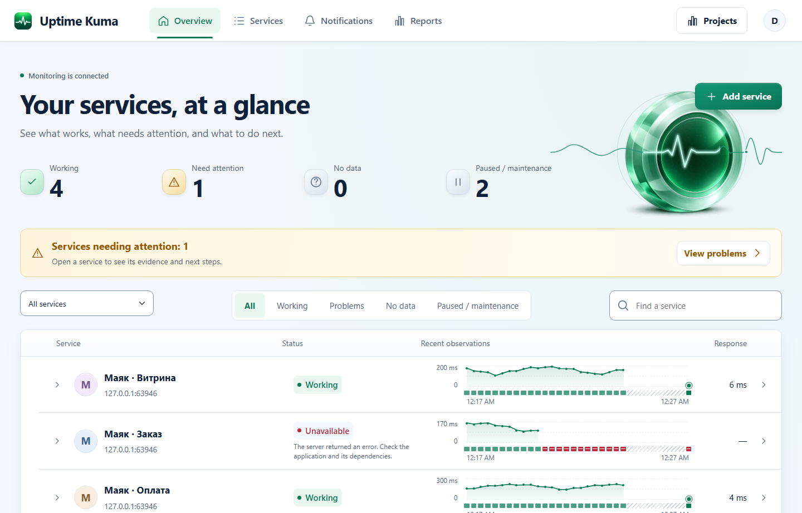
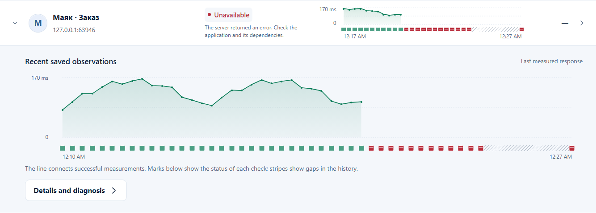
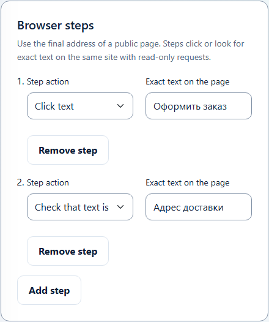
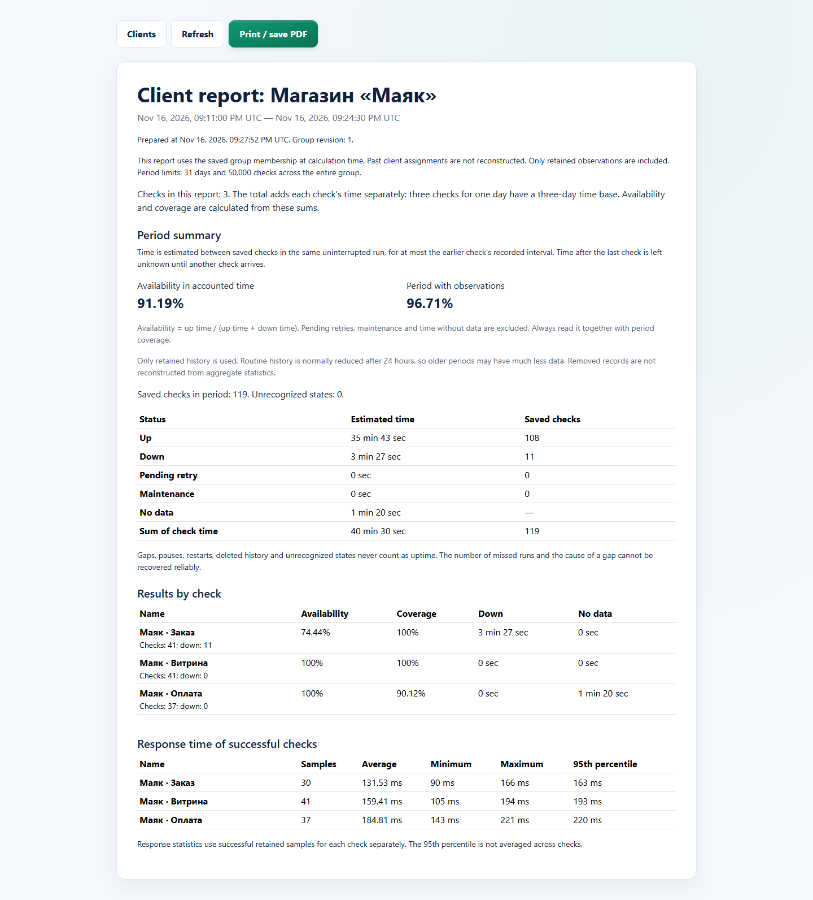

# Uptime Kuma · ub3dqy

**Website and service monitoring on your own server.** See what is working, where a failure happened, and whether someone acknowledged it.

A shop's front page can look fine while the checkout link leads to an error. Kuma follows the steps in a browser, records where the journey stopped, and saves a screenshot. The same dashboard shows what happened before the failure and gives you a report you can send to the client. A second server can check the site from another network, and critical alerts can wait for acknowledgement in Telegram.

[Download the preview](https://github.com/ub3dqy/uptime-kuma/releases/tag/v2.5.8-ub3dqy.preview.2) · [Quick start](#quick-start) · [Читать на русском](README.md)



*The updated Kuma dashboard with sample sites and observation history.*

## What you can do

| Task | What Kuma offers |
| --- | --- |
| Monitor sites and services | Check HTTP(S), response text, ping, ports, DNS, WebSockets, containers and databases. Jobs and services can report in through push checks. See state, response time, history and certificate expiry in the dashboard. |
| Follow a user's journey | Open a page in a browser, click an element by its visible text and check for the expected text. When a step fails, Kuma records the step number and a screenshot. |
| Check from a second network | An independent observer on another server makes its own request. See whether that location also saw a problem. |
| Get critical alerts to a person | Send alerts through Telegram, email and other channels. If Telegram rejects a critical alert or nobody acknowledges it within five minutes, Kuma sends an email to a tested address. The delivery history shows provider acceptance and human acknowledgement. |
| Check in from your phone | Use Telegram to see state and recent history, pause or resume a check, and acknowledge an alert. Access follows the user's project role. |
| Give teammates the right access | Keep checks, channels and actions in projects. Observers can view data, operators can take permitted actions, and administrators manage access. |
| Investigate an incident | When connected, personal diagnostics uses the observations you allow, presents the evidence and suggests what to check next. Selected checks can request diagnostics after an incident. |
| Recover a managed site | With a recovery worker configured, the owner can review a plan, approve an action and check the outcome against new observations. Deploying a code repair requires separately configured access and rollback. |
| Report to a client | Group sites by client, choose a period and save a printable PDF. The report shows outages, maintenance and gaps in observations. Export retained check history as CSV. |
| Communicate planned work | Public status pages show service availability, incident messages and scheduled maintenance. |

## A look around the application

### The history behind a check

Expand a row to see response times and failures in the same chart. Gaps remain visible. Hover, tap or use the keyboard to inspect individual observations.



### A browser check

Choose a page and set the steps a visitor would take. A simple example clicks a checkout link and checks whether the delivery address label appears.



### A client report

Group a client’s sites under **Reports**, choose the dates and open the report. The summary shows the overall figures, followed by the results for each site. Use **Print / save PDF** to save a copy.



[Watch how to create a report · 17 seconds](https://github.com/ub3dqy/uptime-kuma/releases/download/v2.5.8-ub3dqy.preview.2/report-demo-en.mp4)

## Quick start

The ready-to-run archive uses **Docker with Linux x86‑64 containers**. Start with a separate installation and a fresh SQLite database.

1. Download `kuma-preview-linux-amd64.tar.gz` and `SHA256SUMS.txt` from the [release page](https://github.com/ub3dqy/uptime-kuma/releases/tag/v2.5.8-ub3dqy.preview.2), then verify the checksum.
2. In the download directory, run:

   ```sh
   docker load -i kuma-preview-linux-amd64.tar.gz
   docker run --pull=never -d --name uptime-kuma-preview -p 127.0.0.1:3001:3001 -v uptime-kuma-preview-data:/app/data ub3dqy/uptime-kuma:2.5.8-ub3dqy.preview.2
   ```

3. Open <http://127.0.0.1:3001>, select **SQLite**, create an administrator and add a website.
4. Try a report with two checks. For a first browser check, choose a page where you can safely follow a link and look for a heading.

[Full installation and checksum instructions](FORK.md#installation) · [Reports and history export](FORK.md#client-groups-and-printable-reports)

The preview stores data in a separate Docker volume. If you already run Kuma, test the move on a copy of your data. JSONata expression checks are disabled in the archive. Independent observers, Telegram control, diagnostics and recovery require separate configuration.

## Guides

- [Telegram alerts and controls](docs/TELEGRAM-CONTROL.ru.md) (Russian)
- [Independent observer setup](deploy/witness/README.ru.md) (Russian)
- [Project roles and diagnostics](docs/PROJECTS-AND-AI.ru.md) (Russian)
- [Incident diagnostics](docs/EVENT-DIAGNOSIS.ru.md) (Russian)
- [Owner-approved recovery](docs/APPROVED-RECOVERY.ru.md) (Russian)

## Feedback

If you find a bug, include the version, the steps and what happened. If an improvement would help, describe the task you are trying to do and how you work around it today.

[Report a bug](https://github.com/ub3dqy/uptime-kuma/issues/new?template=bug_report.yml) · [Suggest an improvement](https://github.com/ub3dqy/uptime-kuma/issues/new?template=feature_request.yml) · [Report a vulnerability privately](https://github.com/ub3dqy/uptime-kuma/security/advisories/new)

An independent edition based on [Uptime Kuma](https://github.com/louislam/uptime-kuma) 2.5.8 by Louis Lam and contributors. [MIT license](LICENSE).

Dima Mak / [ub3dqy](https://github.com/ub3dqy)
