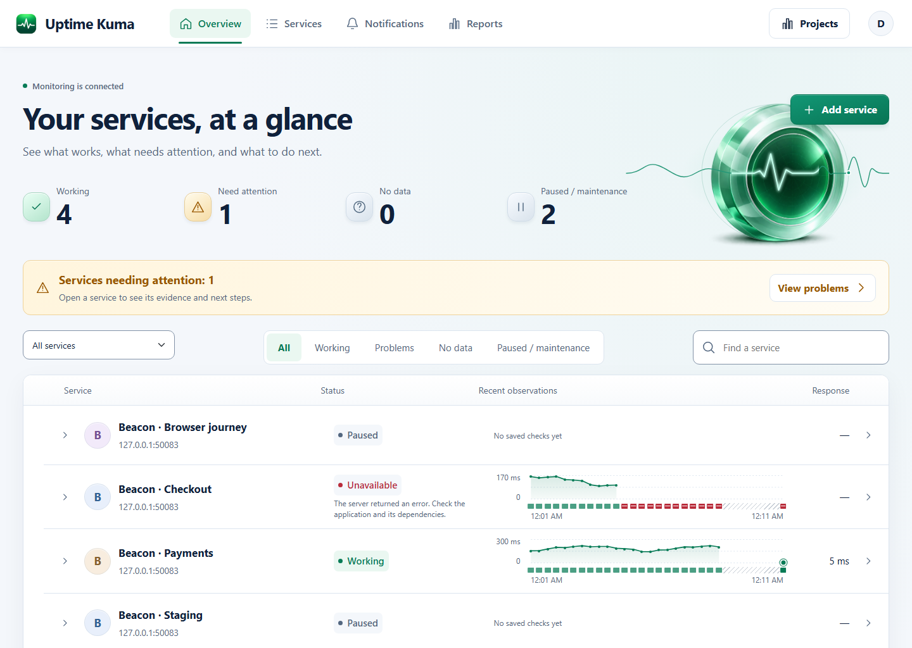
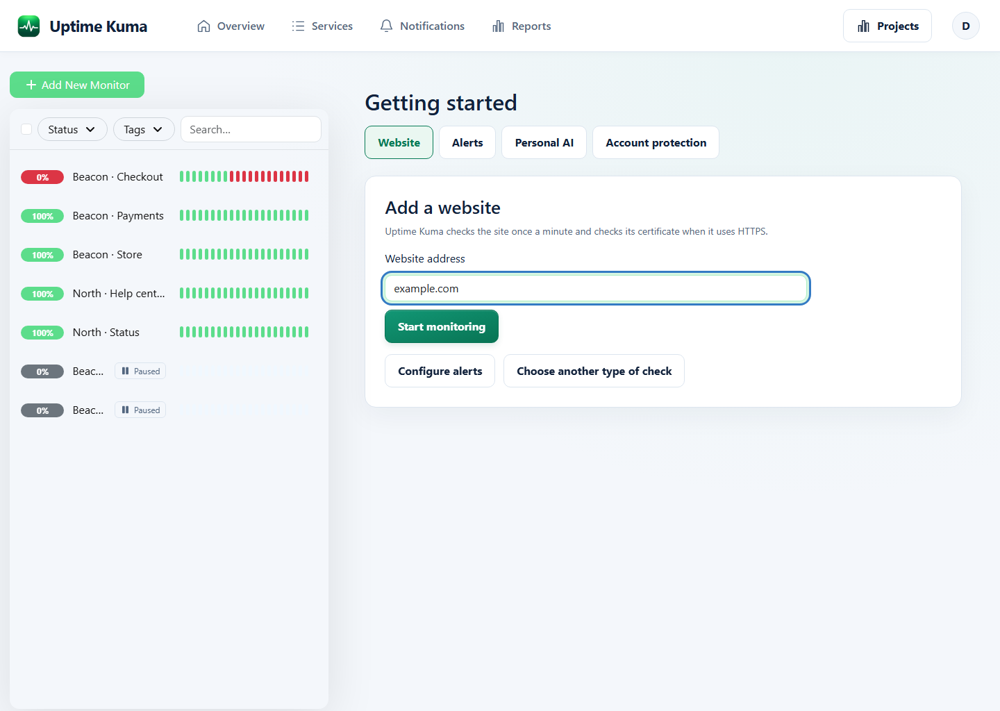
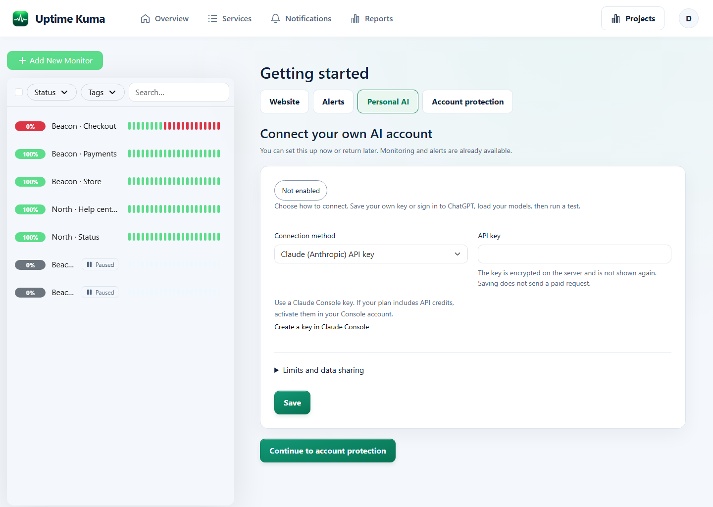
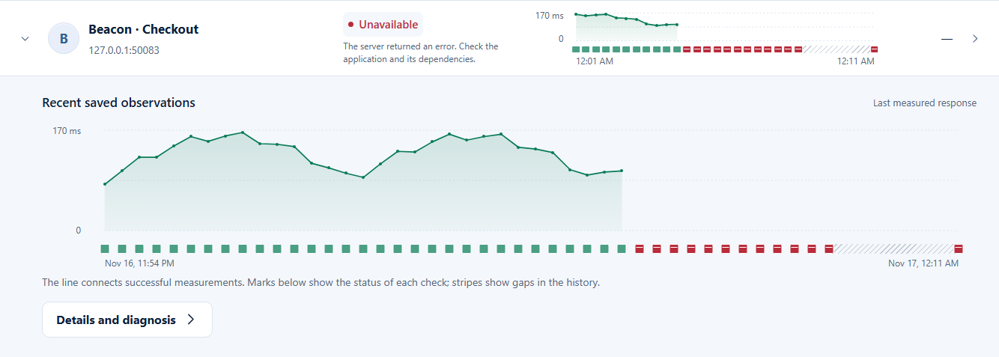
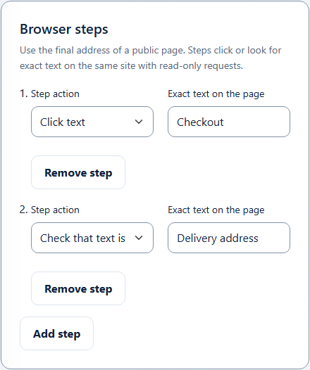
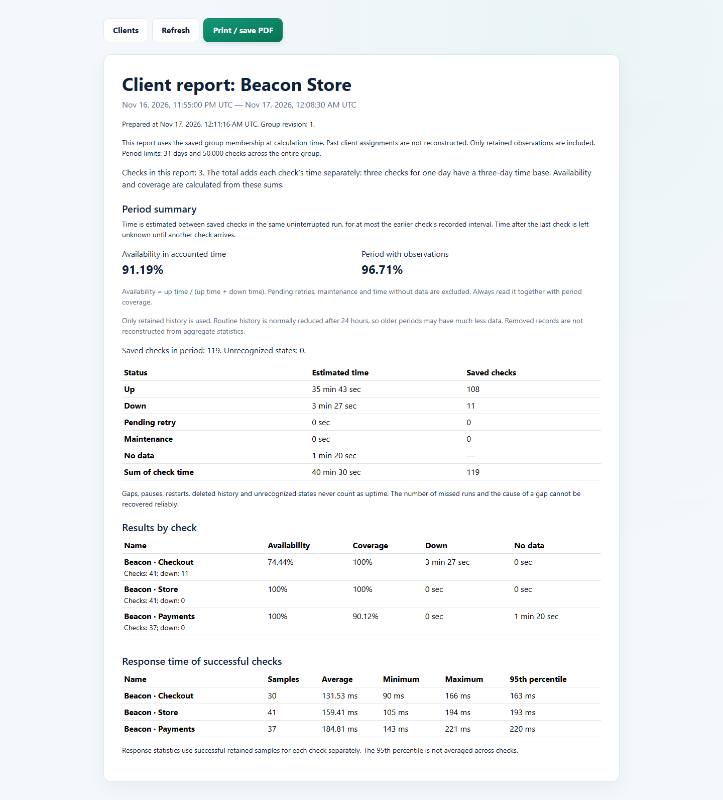

# Uptime Kuma · ub3dqy

[Читать на русском](README.ru.md)

**Website and service monitoring on your own server.** Follow a browser journey, find the failed step and see who acknowledged an alert.

[Quick start](#quick-start) · [Try the preview](https://github.com/ub3dqy/uptime-kuma/releases/tag/v2.5.8-ub3dqy.preview.3) · [Sample client report](https://github.com/ub3dqy/uptime-kuma/releases/download/v2.5.8-ub3dqy.preview.2/client-report-en.pdf)

## What you can do

| Task | What Kuma offers |
| --- | --- |
| Set up your first monitor | The guided setup walks you through adding a site, testing alerts, connecting your AI account and protecting the owner account. The first launch uses a one-time code. |
| Monitor sites and services | Check HTTP(S), response text, ping, ports, DNS, WebSockets, containers and databases. Jobs can report through push checks. The dashboard shows response times, outages, certificate expiry and gaps in observations. |
| Follow a user's journey | Open a page, click an element by its visible text and check for the expected text. A failure records the step and a screenshot. |
| Check from a second network | An independent observer on another server checks the same site. The dashboard shows each location’s result. |
| Get critical alerts to a person | Send alerts through Telegram, email and other channels. Critical alerts can fall back to a tested email channel if Telegram rejects them or nobody acknowledges them within five minutes. Delivery history tracks both provider acceptance and acknowledgement. |
| Manage checks from Telegram | See current state and recent history, pause or resume checks, manage maintenance, acknowledge an alert or request a diagnosis with `/ai`. Actions follow the user's project role. |
| Investigate an incident | Connect an OpenAI API key, sign in to a supported ChatGPT account or use an Anthropic API key for Claude. Personal AI explains the observations you allow it to see. You can enable automatic diagnosis for selected checks. |
| Share responsibility | Give observers, operators and administrators their own access in each project. For configured recovery targets, the owner can review a plan, approve a recovery action and verify the result. |
| Report to a client | Group sites by client, choose a period and save a PDF. Reports show outages, maintenance and observation coverage. Download retained check history as CSV. |
| Publish service status | A status page shows selected services, incident notices and scheduled maintenance. |

## A look around

### Guided setup

Add a website, set up an alert channel, select an AI provider and open the account security settings. You can return to **Settings → Getting started** any time.

### Personal AI

The provider supplies the model catalog for your account. Select a model and send a short test before using it for diagnosis. Decide separately which site names, addresses and history it may use.

### Observation history

Expand a dashboard row to inspect response times, failures and gaps by mouse, touch or keyboard.

### Browser journeys and reports

## Quick start

1. Install and start Docker with Linux containers and Docker Compose.
2. Download **Source code (zip)** from the [current preview](https://github.com/ub3dqy/uptime-kuma/releases/tag/v2.5.8-ub3dqy.preview.3) and extract it.
3. On Windows open **Start-Kuma.cmd**. On Linux or macOS run `bash start-kuma.sh` and open the local link it prints.
4. Create your owner account with a password of at least 15 characters and follow **Getting started**.

The setup uses SQLite and stores data in a dedicated Docker volume. AI is optional. Test upgrades on a copy of your data and keep a backup of the existing installation.

[Install from a checked Docker archive](FORK.md#installation) · [First-run guide](docs/FIRST-STEPS.ru.md) · [AI and project roles](docs/PROJECTS-AND-AI.ru.md) · [Telegram](docs/TELEGRAM-CONTROL.ru.md) · [Independent observer](deploy/witness/README.ru.md)

## Feedback

[Join the seven-day trial](https://github.com/ub3dqy/uptime-kuma/issues/1) · [Report a bug](https://github.com/ub3dqy/uptime-kuma/issues/new?template=bug_report.yml) · [Suggest an improvement](https://github.com/ub3dqy/uptime-kuma/issues/new?template=feature_request.yml) · [Report a vulnerability privately](https://github.com/ub3dqy/uptime-kuma/security/advisories/new)

An independent edition based on [Uptime Kuma](https://github.com/louislam/uptime-kuma) 2.5.8 by Louis Lam and contributors. [MIT license](LICENSE).

Dima Mak / [ub3dqy](https://github.com/ub3dqy)
