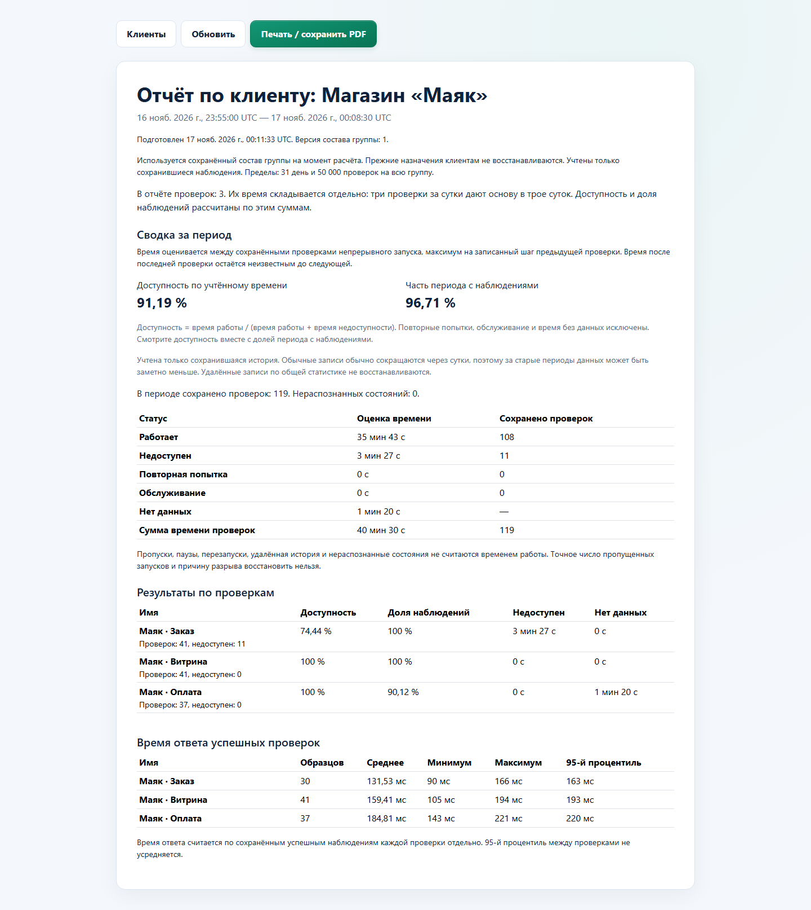

# Uptime Kuma · ub3dqy

[Read in English](README.md)

**Мониторинг сайтов и сервисов на своём сервере.** Видно, что работает, где возник сбой и успел ли кто-то на него отреагировать.

Главная страница магазина открывается, а покупатель нажимает «Оформить заказ» и видит ошибку. Kuma проходит заданный путь в браузере, показывает шаг, на котором он оборвался, и сохраняет снимок страницы. В той же панели можно посмотреть, что происходило до сбоя, и подготовить отчёт для клиента. Второй сервер может перепроверить сайт из другой сети, а важное оповещение ждёт подтверждения в Telegram.

[](https://github.com/ub3dqy/uptime-kuma/releases/download/v2.5.8-ub3dqy.preview.2/pilot-demo-ru.mp4)

[Посмотреть минутное демо](https://github.com/ub3dqy/uptime-kuma/releases/download/v2.5.8-ub3dqy.preview.2/pilot-demo-ru.mp4) · [Открыть пример отчёта в PDF](https://github.com/ub3dqy/uptime-kuma/releases/download/v2.5.8-ub3dqy.preview.2/client-report-ru.pdf)

[](#быстрый-запуск)
[](https://github.com/ub3dqy/uptime-kuma/issues/new?template=bug_report.yml)
[](https://github.com/ub3dqy/uptime-kuma/issues/new?template=feature_request.yml)

[Записаться на недельную пробу](https://github.com/ub3dqy/uptime-kuma/issues/1)

## Что умеет Kuma

| Задача | Что есть в программе |
| --- | --- |
| Следить за сайтами и сервисами | Проверки HTTP(S), текста в ответе, пинга, портов, DNS, WebSocket, контейнеров и баз данных. Сервисы и задания могут сами отмечаться через push-проверку. В панели видны состояния, время ответа, история и срок действия сертификата. |
| Проверить путь пользователя | Браузер открывает страницу, нажимает элемент по видимому тексту и проверяет, появился ли ожидаемый текст. При сбое сохраняются номер шага и снимок страницы. |
| Перепроверить сбой из другой сети | Независимый наблюдатель на втором сервере проверяет сайт и присылает своё наблюдение. Можно увидеть, доступен ли сайт из другой точки. |
| Довести важное оповещение до человека | Telegram, почта и другие каналы. Если Telegram отклонит важное оповещение или за пять минут никто не нажмёт «Принял», Kuma отправит письмо на заранее проверенный адрес. В журнале видно, принял ли канал сообщение и подтвердил ли его человек. |
| Управлять проверками с телефона | В Telegram можно посмотреть состояние и историю, поставить проверку на паузу, возобновить её и подтвердить оповещение. Доступ определяется ролью пользователя. |
| Раздать доступ команде | Проверки, каналы и действия собраны в проектах. Наблюдатель смотрит данные, оператор выполняет разрешённые действия, администратор управляет доступом. |
| Разобраться в причине сбоя | После подключения «Личный ИИ» собирает разрешённые наблюдения, показывает факты и предлагает, что перепроверить. Для выбранных проверок можно запускать диагностику по событию. |
| Восстановить управляемый сайт | При подключённом исполнителе владелец видит план, подтверждает действие и проверяет результат по новым наблюдениям. Сценарии с переносом исправления требуют отдельных настроек доступа и отката. |
| Отчитаться перед заказчиком | Соберите сайты по клиентам, выберите период и сохраните отчёт в PDF. В отчёте отдельно видны простой, обслуживание и время без наблюдений. Историю проверок можно выгрузить в CSV. |
| Сообщить о работах посетителям | Публичные страницы состояния показывают доступность сервисов, сообщения об инцидентах и запланированное обслуживание. |

## Как это выглядит в работе

### История сайта

Раскройте строку сайта на панели, чтобы увидеть время ответа и сбои на одном графике. Пропуск остаётся разрывом. При наведении, касании или выборе с клавиатуры видно время и результат проверки.


### Проверка в браузере

Укажите страницу и шаги, которые обычно проходит посетитель. Для примера достаточно двух действий: нажать «Оформить заказ» и убедиться, что появилась надпись «Адрес доставки».


### Отчёт для клиента

Соберите сайты клиента в группу в разделе **Отчёты**. Выберите период и откройте отчёт. Наверху видна общая картина, ниже — результаты по каждому сайту. Готовый отчёт можно сохранить через **Печать / сохранить PDF**.



## Быстрый запуск

Готовый архив рассчитан на **Docker с Linux x86‑64**. Для первой пробы заведите отдельную установку с чистой базой SQLite.

1. Скачайте `kuma-preview-linux-amd64.tar.gz` и `SHA256SUMS.txt` на [странице выпуска](https://github.com/ub3dqy/uptime-kuma/releases/tag/v2.5.8-ub3dqy.preview.2). Проверьте контрольную сумму архива.
2. В папке с архивом выполните:

   ```sh
   docker load -i kuma-preview-linux-amd64.tar.gz
   docker run --pull=never -d --name uptime-kuma-preview -p 127.0.0.1:3001:3001 -v uptime-kuma-preview-data:/app/data ub3dqy/uptime-kuma:2.5.8-ub3dqy.preview.2
   ```

3. Откройте <http://127.0.0.1:3001>, выберите **SQLite**, создайте администратора и добавьте первый сайт.
4. Для знакомства с возможностями добавьте два сайта в отчёт по клиенту. Для проверки браузера выберите страницу с безопасными действиями, например переход по ссылке и проверку заголовка.

[Установка, проверка архива и запуск из исходного кода](FORK.ru.md#установка) · [Отчёты и выгрузка](FORK.ru.md#клиенты-и-печатные-отчёты)

Пробная сборка хранит данные в отдельном томе. Если уже используете Kuma, проверьте переход на копии данных. Проверки с выражениями JSONata в готовом архиве отключены. Для второго наблюдателя, управления из Telegram, диагностики и восстановления нужна отдельная настройка.

## Руководства

- [Подтверждение оповещений и управление из Telegram](docs/TELEGRAM-CONTROL.ru.md)
- [Как подключить наблюдателя на втором сервере](deploy/witness/README.ru.md#проверка-сайтов-со-второго-сервера)
- [Проекты, роли и подключение диагностики](docs/PROJECTS-AND-AI.ru.md)
- [Диагностика по событию](docs/EVENT-DIAGNOSIS.ru.md)
- [Восстановление с подтверждением владельца](docs/APPROVED-RECOVERY.ru.md)

## Обратная связь

Если проверка дала неожиданный результат, укажите версию, шаги и что получилось. Если не хватает возможности, опишите задачу, которую сейчас приходится решать вручную.

[Сообщить об ошибке](https://github.com/ub3dqy/uptime-kuma/issues/new?template=bug_report.yml) · [Предложить улучшение](https://github.com/ub3dqy/uptime-kuma/issues/new?template=feature_request.yml) · [Сообщить об уязвимости приватно](https://github.com/ub3dqy/uptime-kuma/security/advisories/new)

Самостоятельная версия [Uptime Kuma](https://github.com/louislam/uptime-kuma) на основе 2.5.8. Оригинальный проект создали Louis Lam и участники сообщества. Лицензия [MIT](LICENSE).

Dima Mak / [ub3dqy](https://github.com/ub3dqy)
