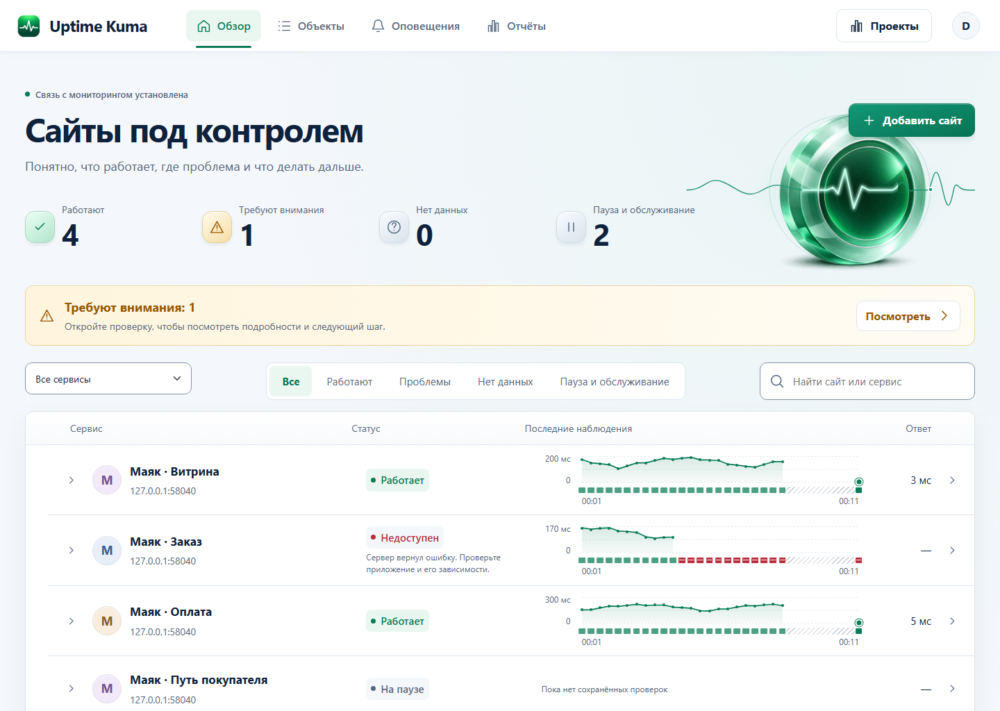
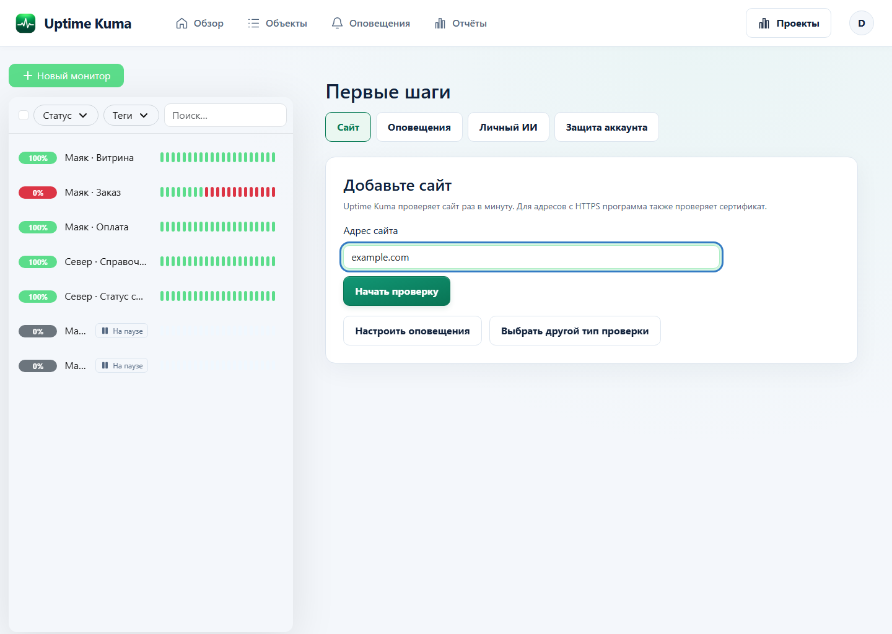
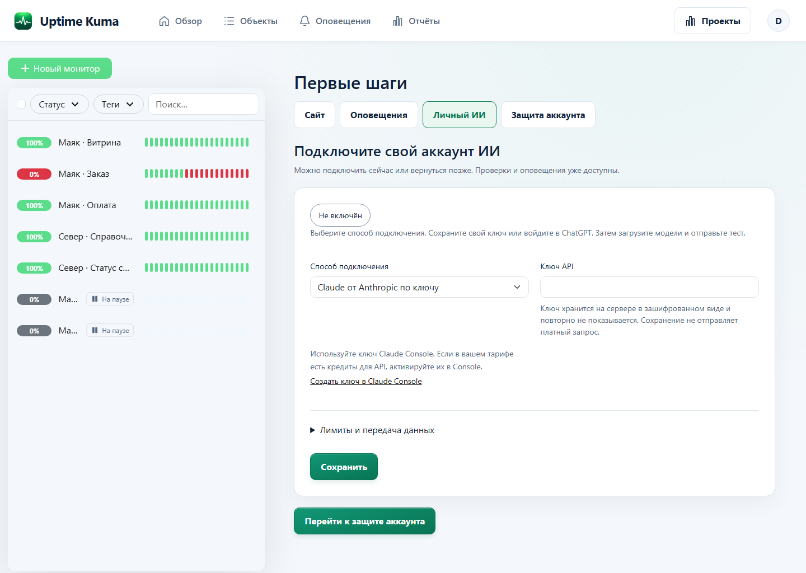
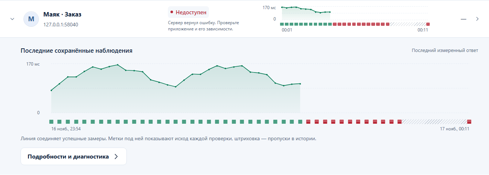
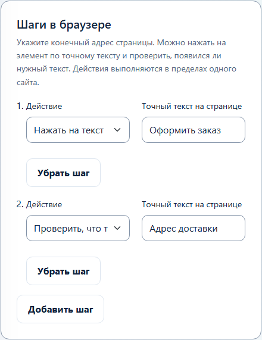

# Uptime Kuma · ub3dqy

[Read in English](README.md)

**Мониторинг сайтов и сервисов на своём сервере.** Видно, на каком шаге возник сбой и кто подтвердил оповещение.

[Быстрый запуск](#быстрый-запуск) · [Попробовать сборку](https://github.com/ub3dqy/uptime-kuma/releases/tag/v2.5.8-ub3dqy.preview.3) · [Пример отчёта для клиента](https://github.com/ub3dqy/uptime-kuma/releases/download/v2.5.8-ub3dqy.preview.2/client-report-ru.pdf)

## Что умеет Kuma

| Задача | Что есть в программе |
| --- | --- |
| Добавить первый сайт | Помощник проведёт через проверку сайта, тест оповещений, подключение ИИ и защиту аккаунта. Для первого запуска используется одноразовый код. |
| Следить за сайтами и сервисами | Проверки HTTP(S), текста в ответе, пинга, портов, DNS, WebSocket, контейнеров и баз данных. Задания могут сами отмечаться через push-проверку. В панели видны время ответа, сбои, срок действия сертификата и пропуски наблюдений. |
| Проверить путь посетителя | Браузер открывает страницу, нажимает элемент по видимому тексту и проверяет, появился ли ожидаемый текст. При сбое сохраняются номер шага и снимок страницы. |
| Перепроверить сайт из другой сети | Независимый наблюдатель на втором сервере делает свою проверку. В панели видны результаты из обеих точек. |
| Довести важное оповещение до человека | Уведомления через Telegram, почту и другие каналы. Если Telegram отклонит важное сообщение или за пять минут его никто не подтвердит, Kuma отправит письмо на проверенный адрес. В журнале видны приём сообщения службой и подтверждение человеком. |
| Управлять проверками с телефона | В Telegram можно посмотреть состояние и историю, поставить проверку на паузу, возобновить её, назначить техработы, подтвердить оповещение и запросить диагностику по команде `/ai`. Доступ задаётся ролью в проекте. |
| Разобраться в сбое | «Личный ИИ» подключается ключом OpenAI, входом в поддерживаемый аккаунт ChatGPT или ключом Anthropic для Claude. Он объясняет разрешённые наблюдения. Для выбранных проверок можно включить диагностику при сбое. |
| Работать командой | В каждом проекте можно дать людям права наблюдателя, оператора или администратора. Если подключена служба восстановления, владелец может проверить план, подтвердить действие и посмотреть результат. |
| Отчитаться перед клиентом | Объедините сайты клиента в группу, выберите период и сохраните отчёт в PDF. В нём видны сбои, техработы и полнота наблюдений. Историю проверок можно выгрузить в CSV. |
| Показать состояние посетителям | Страница статуса показывает выбранные сервисы, сообщения о сбоях и запланированные работы. |

## Как выглядит программа

### Первые шаги

Добавьте сайт, проверьте оповещения, при желании подключите ИИ и откройте настройки защиты. К помощнику можно вернуться через **Настройки → Первые шаги**.

### Личный ИИ

После подключения загрузите список моделей своего аккаунта, выберите модель и отправьте короткий тест. Вы сами решаете, передавать ли ИИ названия сайтов, адреса и историю.

### История наблюдений

Раскройте строку на главной панели, чтобы посмотреть подробности. На графике видны время ответа, сбои и пропуски. Точку можно выбрать мышью, касанием или клавиатурой.

### Проверка в браузере и отчёт

## Быстрый запуск

1. Установите и запустите Docker с поддержкой Linux-контейнеров и Docker Compose.
2. Скачайте **Source code (zip)** на странице [текущего пробного выпуска](https://github.com/ub3dqy/uptime-kuma/releases/tag/v2.5.8-ub3dqy.preview.3) и распакуйте архив.
3. На Windows откройте **Start-Kuma.cmd**. На Linux или macOS выполните `bash start-kuma.sh` и откройте напечатанную ссылку.
4. Создайте аккаунт владельца с паролем от 15 символов и пройдите **Первые шаги**.

Программа создаст базу SQLite в отдельном томе Docker. Подключить ИИ можно позже. Перед переносом действующей установки сохраните её копию и проверьте обновление на отдельных данных.

[Установка из проверенного Docker-архива](FORK.ru.md#установка) · [Подробная инструкция первого запуска](docs/FIRST-STEPS.ru.md) · [ИИ и роли в проектах](docs/PROJECTS-AND-AI.ru.md) · [Telegram](docs/TELEGRAM-CONTROL.ru.md) · [Второй сервер наблюдений](deploy/witness/README.ru.md)

## Обратная связь

[Записаться на недельную пробу](https://github.com/ub3dqy/uptime-kuma/issues/1) · [Сообщить об ошибке](https://github.com/ub3dqy/uptime-kuma/issues/new?template=bug_report.yml) · [Предложить улучшение](https://github.com/ub3dqy/uptime-kuma/issues/new?template=feature_request.yml) · [Сообщить об уязвимости приватно](https://github.com/ub3dqy/uptime-kuma/security/advisories/new)

Самостоятельная версия [Uptime Kuma](https://github.com/louislam/uptime-kuma) на основе 2.5.8. Оригинальный проект создали Louis Lam и участники сообщества. Лицензия [MIT](LICENSE).

Dima Mak / [ub3dqy](https://github.com/ub3dqy)
